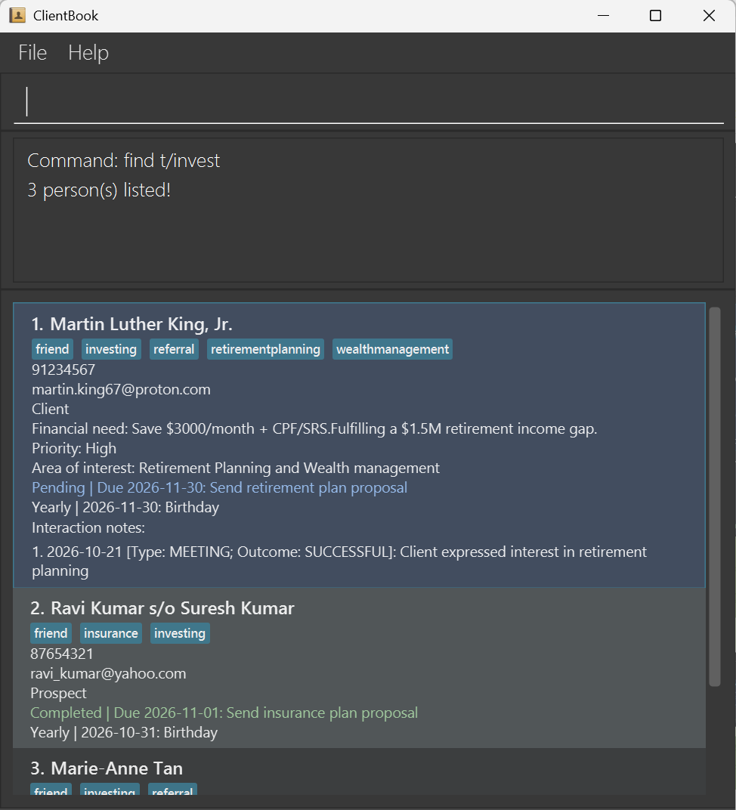

# ClientBook User Guide

ClientBook is a desktop application for financial consultants to manage clients and prospects, recall their
high-level financial needs, and record dated interactions. It supports typed commands with a graphical interface
and stores records locally.

<!-- * Table of Contents -->
<page-nav-print />

--------------------------------------------------------------------------------------------------------------------

## Quick start

1. Ensure that Java `25` or later is installed on your computer. 
   **Mac users:** Ensure you have the precise JDK version prescribed [here](https://se-education.org/guides/tutorials/javaInstallationMac.html).

2. Download the latest `.jar` file from the [ClientBook releases](https://github.com/AY2627S1-CS2103T-F14a-4/tp/releases).

3. Copy the file to the folder you want to use as the _home folder_ for your AddressBook.

4. Open a terminal, `cd` to the folder containing the JAR file, and run `java -jar addressbook.jar`. 
   A GUI similar to the one below should appear in a few seconds. Your address book starts empty. 
   

5. Type a command in the command box and press Enter to execute it. For example, type **`help`** and press Enter to open the help window. 
   Some example commands you can try:

   * `list` : Lists all contacts.

   * `add r/Client n/John Doe e/johnd@example.com p/98765432` : Adds a client contact named `John Doe`.

   * `delete 3` : Deletes the 3rd contact shown in the current list.

   * `clear` : Deletes all contacts.

   * `exit` : Exits the app.

6. Refer to the [Features](#features) section below for details of each command.

--------------------------------------------------------------------------------------------------------------------

## Features

<box type="info" seamless>

**Notes about the command format:** 

* Words in `UPPER_CASE` are the parameters to be supplied by the user. 
  For example, in `add n/NAME`, replace `NAME` with a value such as `John Doe`.

* Items in square brackets are optional. 
  For example, `n/NAME [t/TAG]` can be used as `n/John Doe t/friend` or as `n/John Doe`.

* Items followed by `...` can appear zero or more times. 
  For example, `[t/TAG]... ` may be omitted, or written as `t/friend` or `t/friend t/family`.

* Parameters can be in any order. 
  For example, if the command specifies `n/NAME p/PHONE_NUMBER`, `p/PHONE_NUMBER n/NAME` is also acceptable.

* Extraneous parameters for commands that take no parameters, such as `help`, `list`, `exit`, and `clear`, are ignored. 
  For example, `help 123` is interpreted as `help`.

* If you are using a PDF version of this document, be careful when copying and pasting commands that span multiple lines as space characters surrounding line-breaks may be omitted when copied over to the application.
</box>

### Viewing help: `help`

Shows a message explaining how to access the help page.

Format: `help`

### Adding a person: `add`

Adds a person to the address book.

Format: `add r/RELATIONSHIP n/NAME e/EMAIL p/PHONE_NUMBER`

<box type="tip" seamless>

* `RELATIONSHIP` must be either `Client` or `Prospect`.
* `NAME` must contain 1–100 characters after leading and trailing whitespace is removed. It may include letters,
  spaces, hyphens (`-`), apostrophes (`'`), and the relationship markers `s/o`, `d/o`, or `w/o`.
* `EMAIL` must contain one `@`, no whitespace, text in both the local and domain parts, and at least one dot in the
  domain. Its local part may use common characters such as `.`, `_`, `+`, and `-`; each domain label may use
  letters, digits, and hyphens.
* Parameters may be entered in any order.
</box>

Examples:
* `add r/Client n/John Doe e/john.doe@example.com p/91234567`
* `add n/Ravi s/o Kumar p/98765432 r/Prospect e/ravi.kumar@example.com`
* `add r/Client n/Jane Tan e/jane+client@firm.co.uk p/98765432`

### Listing all persons: `list`

Shows a list of all persons in the address book.

Format: `list`

### Editing a person: `edit`

Edits an existing person in the address book.

Format: `edit INDEX [r/RELATIONSHIP] [n/NAME] [p/PHONE] [e/EMAIL]`

* Edits the person at the specified `INDEX`. The index refers to the index number shown in the displayed person list. The index **must be a positive integer** 1, 2, 3, ...
* At least one of the optional fields must be provided.
* Existing values will be updated to the input values.
* `RELATIONSHIP` must be either `Client` or `Prospect`.

Examples:
*  `edit 1 p/91234567 e/johndoe@example.com` Edits the phone number and email address of the 1st person to be `91234567` and `johndoe@example.com` respectively.
*  `edit 1 r/Client` Changes the 1st person's relationship to `Client`.
*  `edit 2 n/Betsy Crower` Edits the name of the 2nd person to be `Betsy Crower`.

### Updating client financial information: `info`

Adds, updates, or clears a person's financial need, priority, and area of interest. Present fields appear on the person's card as
`Financial need: VALUE`, `Priority: VALUE`, and `Area of interest: VALUE`. Absent fields are hidden.

Format: `info INDEX [/fn VALUE|-] [/pr VALUE|-] [/ai VALUE|-]`

* `INDEX` refers to the index in the currently displayed list, including filtered search results. It must be a positive
  integer (1, 2, 3, ...) corresponding to an existing person in that list.
* At least one of `/fn`, `/pr`, or `/ai` is required. Each parameter may be supplied at most once, in any order.
* Normal supplied values replace existing values. Omitted fields remain unchanged.
* An exact `-` value clears only that field. Surrounding ordinary spaces are ignored, so `/pr   -   ` also clears
  priority. Clearing an already absent field is safe. A hyphen in a larger value, such as `Long-term`, remains text.
* Each value must contain 1-200 characters after leading and trailing ordinary spaces are ignored. Internal spaces are
  preserved. Empty values and bare prefixes (for example, `info 1 /pr`) remain invalid; clearing requires explicit `-`.
* Allowed characters are letters, digits, spaces, periods (`.`), commas (`,`), apostrophes (`'`), hyphens (`-`),
  parentheses (`(` and `)`), and ampersands (`&`). Tabs and line breaks are not allowed.
* Forward slash (`/`) is not allowed in a value because it is reserved for parameter prefixes.

Examples:

* `info 1 /fn retirement planning`
* `info 2 /pr protect family income /ai life insurance`
* `info 1 /ai investment products /fn wealth accumulation /pr preserve capital`
* `info 1 /pr -` clears only priority.
* `info 1 /fn - /ai -` clears financial need and area of interest, leaving priority unchanged.
* `info 1 /pr High /ai -` sets priority to `High` and clears area of interest, leaving financial need unchanged.

### Recording preferred contact channel and timing: `contact`

Records how and when a client or prospect prefers to be contacted.

Format: `contact INDEX [ch/CHANNEL] [tm/TIMING]`

* `INDEX` is a positive integer referring to the currently displayed list, including after a search.
* Supply at least one of `ch/` or `tm/`, each at most once, in either order. Separate prefixes with spaces.
* Each supplied value replaces the previous value; omitted preferences and all other person details remain unchanged.
* Values must contain 1–200 characters after surrounding whitespace is trimmed. Internal spaces and case are preserved.
  Free text, Unicode and punctuation are accepted, for example `WhatsApp` and `Weekdays 6:30–8 pm`.
* Empty or whitespace-only values are rejected. Preferences cannot be cleared with this command.
* The person's card displays each recorded preference, wrapping long values. Unset preferences are hidden.
* Preferences are saved automatically. Older data files without these fields load with no preferences.

Examples:

* `contact 1 ch/WhatsApp tm/Weekdays after 6 pm`
* `contact 2 tm/Lunch break ch/Phone call`
* `contact 1 tm/Weekends 10 am to noon` (keeps the existing channel)

Success message: `Updated contact preferences for PERSON_NAME.`

Missing or invalid indices produce `Index must be a positive integer.` An index outside the displayed list
produces `The person index provided is invalid.` Missing fields produce `At least one of ch/ or tm/ is required.`
Duplicate `ch/` or `tm/` prefixes are rejected. These recognized prefixes, when preceded by a space,
are delimiters and cannot be included literally in values. Other slash-containing text, such as `AM/PM`
or `Phone/WhatsApp`, is preserved as part of the value.

### Adding a dated interaction note: `note`

Appends a dated note to a client or prospect. Notes appear on the person's card in the order they were added.

Format: `note INDEX d/DATE n/NOTE`

* `INDEX` refers to the currently displayed list, including search results.
* `DATE` must be a real calendar date in `yyyy-MM-dd` format. Past dates are accepted.
* Put the date before `n/`. Everything after `n/` is note text, including URLs, punctuation and prefix-like text.
* Note text cannot be blank. Surrounding whitespace is removed; case and internal text are preserved.
* Adding a note keeps all previous notes. Same-date and identical notes are allowed.
* Notes are saved automatically and preserved when using `edit` or `info`.
* Each entry shows its date and text under **Interaction notes:** on the person's card. Long text wraps, and the
  card grows to fit its contents immediately. Scroll the client list to read longer histories.
* There is no maximum note length imposed by this command. Enter a note on one command line.

Example: `note 1 d/2026-10-06 n/Discussed retirement planning and agreed to follow up next month.`

Success message: `Added interaction note for PERSON_NAME.`

Examples of other accepted notes:

* `note 1 d/2020-02-29 n/Reviewed the client's long-term goals.` (Backdated entry.)
* `note 1 d/2026-10-06 n/Shared https://example.com/plans/retirement; discussed option A/B.`

Missing indices, dates or note prefixes produce an error. Dates such as `2026-02-30` are rejected with
`Interaction date must be a valid date in yyyy-MM-dd format.` Blank note text produces
`Interaction note cannot be empty.` An index outside the displayed list produces
`The person index provided is invalid.` These input errors leave the stored records unchanged.

Notes are displayed in insertion order, including backdated entries; they are not sorted by date.
Searching interaction notes is not currently supported.

### Editing a dated interaction note: `noteedit`

Updates the text of one existing interaction note belonging to a client or prospect.

Format: `noteedit CONTACT_INDEX NOTE_INDEX n/NEW_NOTE_CONTENT`

* Both indices must be positive integers. `CONTACT_INDEX` refers to the currently displayed contact list,
  including search results. The current search filter remains active after editing.
* `NOTE_INDEX` is the number displayed beside the note under **Interaction notes:** on that contact's card.
  Numbering starts at 1 and follows insertion order, rather than date order.
* The original interaction date, other notes, and all other contact information are preserved.
* New text cannot be blank. Surrounding whitespace is removed; case and internal text are preserved.
  Everything after `n/` is note text, including URLs and prefix-like strings. Enter it on one command line.
* Changes are saved automatically.

Example: `noteedit 1 2 n/Discussed insurance renewal`

This updates the second note of the first displayed contact. Success message:
`Updated interaction note 2 for PERSON_NAME.`

Missing arguments or the `n/` prefix, invalid indices, and blank text produce an error without changing records.
An out-of-range contact index produces `The person index provided is invalid.` An out-of-range note index,
including when the contact has no notes, produces `The interaction note index provided is invalid.`
Blank text produces `Interaction note cannot be empty.`

### Deleting a dated interaction note: `notedelete`

Deletes one interaction note belonging to a client or prospect.

Format: `notedelete CONTACT_INDEX NOTE_INDEX`

* Both indices must be positive integers. `CONTACT_INDEX` refers to the currently displayed contact list,
  including search results. The current filter remains active after deletion.
* `NOTE_INDEX` is the number displayed beside the note under **Interaction notes:** on that contact's card.
  Numbering starts at 1 and follows insertion order, rather than date order (e.g., `1. 2026-10-15: Called`).
* Only the specified note is removed, even if identical notes exist. Remaining notes retain their order,
  dates and text; subsequent displayed note numbers shift down by one automatically.
* All other contact information is preserved, including financial information, tags, contact preferences
  and next actions. Deleting the last note leaves the contact with an empty history.
* Changes are saved automatically and remain after restarting the application.

Example: `notedelete 1 2`

This deletes the second note of the first displayed contact. Success message:
`Deleted interaction note 2 for PERSON_NAME (2026-10-18): Client interested in investment`

The message includes the deleted note's original date and an excerpt of its content. Whitespace in the excerpt
is collapsed to single spaces. At most 80 Unicode code points of content are shown, followed by `…` if truncated.
This formatting does not change stored note content. Deletion cannot be undone.

Missing or extra arguments and invalid indices produce an error without changing records.
An out-of-range contact index produces `The person index provided is invalid.` An out-of-range note index,
including when the contact has no notes, produces `The interaction note index provided is invalid.`

### Locating persons by name or relationship: `find`

Finds persons whose names contain any of the given keywords, or filters persons by their relationship.

Formats:

* `find KEYWORD [MORE_KEYWORDS]`
* `find r/RELATIONSHIP`
* `find KEYWORD [MORE_KEYWORDS] r/RELATIONSHIP`

* Name keywords and relationship values are case-insensitive; for example, `hans` matches `Hans`, and `client`
  matches `Client`.
* Keyword order does not matter; for example, `Hans Bo` matches `Bo Hans`.
* Keyword searches consider only names.
* Only full words match; for example, `Han` does not match `Hans`.
* Persons matching at least one keyword are returned (an `OR` search); for example, `Hans Bo` returns `Hans Gruber` and `Bo Yang`.
* `RELATIONSHIP` must be either `client` or `prospect` and is case-insensitive.
* Name keywords can be combined with a relationship filter. A result must match at least one name keyword
  **and** the relationship. Put name keywords before `r/`.
* Persons filtered by relationship retain the same order as in the `list` command.

Examples:
* `find John` returns `john` and `John Doe`
* `find alex david` returns `Alex Yeoh`, `David Li` 
  
* `find r/client` returns all clients.
* `find r/Prospect` returns all prospects.
* `find alex david r/prospect` returns prospects whose names contain the full word `alex` or `david`.

### Deleting a client/prospect: `delete`

Deletes a client or prospect, including their financial information and interaction notes.

Format: `delete INDEX`

Use the positive index number shown beside the person you want to delete. Only one index is accepted;
spaces before and after it are ignored. The remaining records are renumbered after deletion.

For example, `list` followed by `delete 2` deletes the second person in the full list.
After `find Jane`, `delete 1` deletes the first search result, even if that person had a different index
in the full list. The search stays active; use `list` to see everyone who remains.

The success message includes the person's relationship and name: `Client John Doe has been deleted successfully.`
or `Prospect Jane Tan has been deleted successfully.`

Deletion is saved automatically and cannot be undone, so check the displayed name and index before proceeding.
Other records and their details are kept.

If a delete command is rejected, the records and search results stay unchanged:

Input | Error message
------|--------------
`delete` | `Client index is required.`
`delete 1 2` or `delete 1 abc` | `Delete command only accepts a client index.`
`delete 0`, `delete -1`, `delete abc`, or `delete 1.5` | `Client index must be a positive integer.`
`delete 3` when fewer than three records are displayed | `No client exists at index 3.`

### Recording the next action: `next`

Records one follow-up for a client or prospect in the currently displayed list.

Format: `next INDEX a/ACTION d/yyyy-MM-dd`

* Use the positive index shown beside the person. After `find`, use the index in those results.
* Both prefixes are required, may appear in either order, and must each appear exactly once.
  Separate the index and prefixes with spaces.
* The action must contain 1–200 characters after surrounding whitespace is removed.
* The due date must be a real date in years `0001` to `9999`, with exactly four year digits
  and two month/day digits. Past dates are accepted. For example, `0000-01-01`, `2026-02-30`
  and `2026-2-03` are rejected.
* Each person has at most one next action. Running `next` again replaces the previous action and date,
  and resets its status to pending, even if the previous action was completed.
* The person's contact details, financial information, tags and interaction notes are preserved.

Example: `next 1 a/Send retirement proposal d/2026-10-20`

The success message is `Next action for NAME has been updated successfully.`
The card shows the description, due date and a text status: `Pending`, `Overdue`, or `Completed`.
An incomplete action becomes overdue when its date is earlier than the computer's current local date.
An action due today is pending. Cards without a next action do not show this area.
Status is calculated when a card is rendered. If the app stays open overnight, restart it to refresh all card labels.

Input | Error message
------|--------------
`next` | `Person index is required.`
`next 1 d/2026-10-20` | `Next action is required: use a/ACTION.`
`next 1 a/Call` or `next 1 a/Call d/` | `Due date is required: use d/yyyy-MM-dd.`
`next 0 a/Call d/2026-10-20` or a negative/non-integer index | `Index must be a positive integer.`
`next 99 a/Call d/2026-10-20` when fewer than 99 people are displayed | `The person index provided is invalid.`
`next 1 a/ d/2026-10-20` or an action over 200 characters | `Next action must contain 1 to 200 characters.`
`next 1 a/Call d/2026-02-30` | `Due date must be a valid date in yyyy-MM-dd format.`

Repeated `a/` or `d/` prefixes produce the standard duplicate-prefix error. Space-prefixed `a/` and `d/`
are reserved delimiters and cannot appear literally within the description. URLs such as `https://example.com`
and other text are accepted. Rejected commands leave the person's data unchanged.

### Completing a follow-up: `done`

Marks the next action of a client or prospect in the currently displayed list as completed.

Format: `done INDEX`

Use the positive index shown beside the person. After `find`, use the index in the search results.
For example, `done 1` completes the first displayed person's next action. The action description and
its date are kept, and the card shows `Completed`. Contact details, financial information, tags and
interaction notes are preserved. The current search filter remains active.

The success message is `Next action for NAME has been marked as completed.`
If the action is already completed, repeating `done` returns the normal message
`Next action for NAME is already completed.` without changing the record or current filter.
Running `next` for that person later replaces the action and resets its status to pending.

The command checks these conditions in the order shown; a rejected command leaves all data unchanged:

Condition | Error message
----------|--------------
The index is outside the currently displayed list | `The person index provided is invalid.`
The person has no next action | `NAME has no next action to complete.`

`done` without an index reports `Person index is required.`. Zero, negative numbers, non-integers,
and extra arguments such as `done 1 2` report `Index must be a positive integer.`.

### Viewing due follow-ups: `due`

Shows every client or prospect whose incomplete next action is due today or earlier.

Format: `due`

* Includes actions due today and overdue actions, using your computer's local date.
* Excludes completed actions, future actions and people without a next action.
* Replaces any previous `find` filter. Results keep their existing order and are not sorted by due date.
* Use the displayed index for subsequent commands. After `done 1`, the completed person disappears
  from the due list and the remaining displayed indices update.
* Use `list` to see everyone again. Run `due` again to refresh the date after midnight.

For example, if today is `2026-10-20`, `due` includes incomplete actions dated `2026-10-19`
and `2026-10-20`, but excludes an action dated `2026-10-21`.
The result message is `2 follow-up(s) due today or earlier.` when two people match,
or `No follow-ups are due.` when nobody matches.

Arguments are not accepted: `due 1` reports `The due command takes no arguments.`.

### Clearing all entries: `clear`

Clears all entries from the address book.

Format: `clear`

### Exiting the program: `exit`

Exits the program.

Format: `exit`

### Saving the data

AddressBook automatically saves data after every command. You do not need to save manually.

### Editing the data file

AddressBook data is saved automatically as a JSON file `[JAR file location]/data/addressbook.json`. Advanced users are welcome to update data directly by editing that data file.

<box type="warning" seamless>

**Caution:**
If your changes make the data file invalid, AddressBook starts with an empty address book at the next run. The invalid file remains on disk until you run a command (AddressBook saves after every command). Still, we recommend backing up the file before editing it. 
Furthermore, certain edits can cause the AddressBook to behave in unexpected ways (e.g., if a value entered is outside of the acceptable range). Therefore, edit the data file only if you are confident that you can update it correctly.
</box>

### Archiving data files `[coming in v2.0]`

_Details coming soon ..._

--------------------------------------------------------------------------------------------------------------------

## FAQ

**Q**: How do I transfer my data to another computer? 
**A**: Install the app on the other computer and overwrite the data file it creates with the data file from your previous AddressBook home folder.

--------------------------------------------------------------------------------------------------------------------

## Known issues

1. **When using multiple screens**, if you move the application to a secondary screen, and later switch to using only the primary screen, the GUI will open off-screen. The remedy is to delete the `preferences.json` file created by the application before running the application again.
2. **If you minimize the Help Window** and then run the `help` command (or use the `Help` menu, or the keyboard shortcut `F1`) again, the original Help Window will remain minimized, and no new Help Window will appear. The remedy is to manually restore the minimized Help Window.

--------------------------------------------------------------------------------------------------------------------

## Command summary

Action     | Format, Examples
-----------|----------------------------------------------------------------------------------------------------------------------------------------------------------------------
**Add**    | `add r/RELATIONSHIP n/NAME e/EMAIL p/PHONE_NUMBER`   e.g., `add r/Client n/James Ho e/jamesho@example.com p/22224444`
**Clear**  | `clear`
**Delete** | `delete INDEX`  e.g., `delete 3`
**Edit**   | `edit INDEX [r/RELATIONSHIP] [n/NAME] [p/PHONE_NUMBER] [e/EMAIL]`  e.g.,`edit 2 r/Client n/James Lee e/jameslee@example.com`
**Find**   | `find KEYWORD [MORE_KEYWORDS] [r/RELATIONSHIP]` or `find r/RELATIONSHIP`  e.g., `find James Jake`, `find r/client`, `find James r/prospect`
**Contact** | `contact INDEX [ch/CHANNEL] [tm/TIMING]`  e.g., `contact 1 ch/WhatsApp tm/After 6 pm`
**Info**   | `info INDEX [/fn VALUE\|-] [/pr VALUE\|-] [/ai VALUE\|-]`  e.g., `info 1 /fn retirement planning`
**Note**   | `note INDEX d/DATE n/NOTE`  e.g., `note 1 d/2026-10-06 n/Discussed retirement planning.`
**Note edit** | `noteedit CONTACT_INDEX NOTE_INDEX n/NEW_NOTE_CONTENT`  e.g., `noteedit 1 2 n/Discussed insurance renewal`
**Note delete** | `notedelete CONTACT_INDEX NOTE_INDEX`  e.g., `notedelete 1 2`
**Next**   | `next INDEX a/ACTION d/yyyy-MM-dd`  e.g., `next 1 a/Call d/2026-10-20`
**Done**   | `done INDEX`  e.g., `done 1`
**Due**    | `due`
**List**   | `list`
**Help**   | `help`

